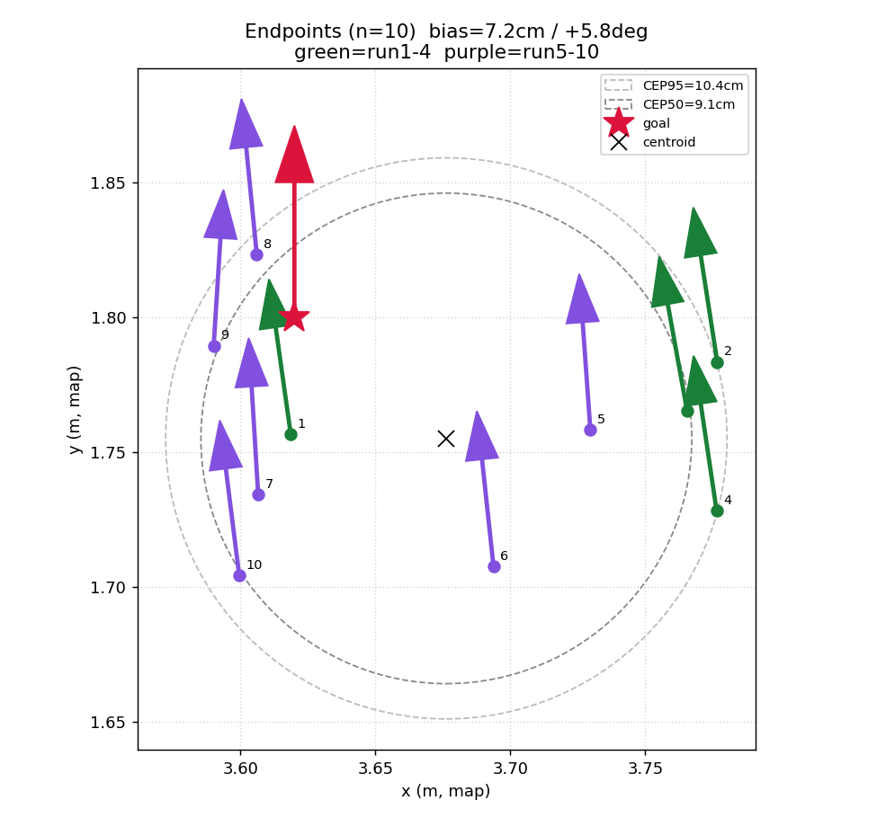
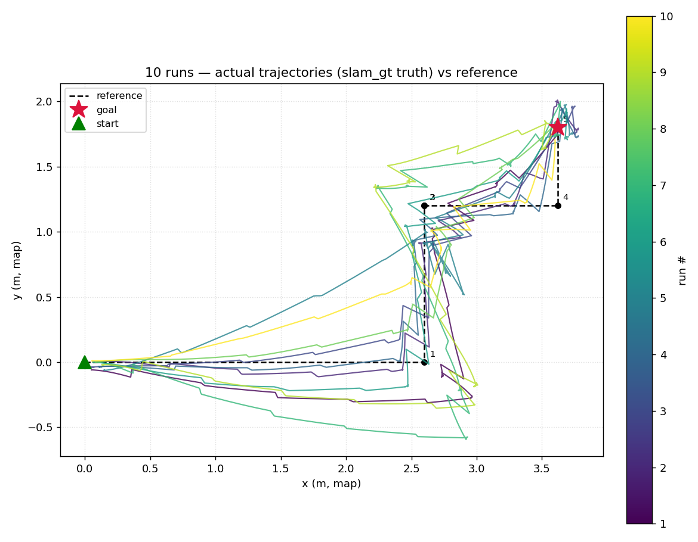
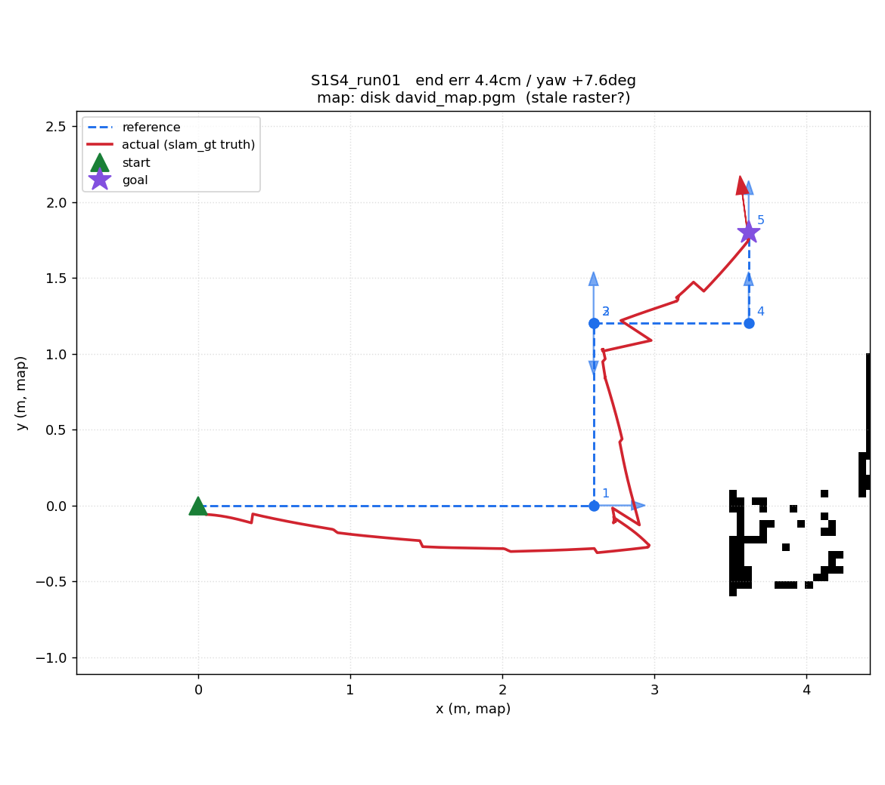

# position_controller 固定测试报告 —— 10 次重复

- 日期：2026-07-07
- 被测：`position_controller`（waypoint 栈的驱动器,turn-drive-turn 定点）
- 框架：[`scripts/controller_bench/`](../../scripts/controller_bench/)（设计见
  [固定测试用例设计](2026-07-07-nav-fixed-testcase-design.md)）
- 真值：`david_slam_gt` localization 的 `/groundtruth/pose`（slam_toolbox 锁图,map 系
  base_footprint,20Hz;**忽略定位漂移,当绝对真值**）
- 样本：**10 次成功 run**（另有 3 次 setup 阶段 infra abort,见 §2）

---

## TL;DR

| 维度 | 结果 | 判读 |
|---|---|---|
| **可靠性** | 驱动 **10/10** 段段成功;3 次 setup abort(真值/控制器没起) | ✅ 控制链稳,infra 需 checklist |
| **精确性·位置** | 均值 **9.8cm**,max 17.2cm;**bias +7.2cm**(+5.6 x / −4.5 y) | ⚠ 有系统性偏移(可调) |
| **精确性·朝向** | 均值 **6.6°**,max 10.3°;**bias +5.8°**(质心 95.8°) | ⚠ 系统性 yaw 超调 |
| **稳定性** | std_x 7.6 / std_y 3.6cm,yaw std 3.7°;CEP50 9.1 / CEP95 10.4cm | 但分布**双峰**(见 §4) |
| **跟踪** | cross-track RMS 均值 **17.2cm**,最差单点 67cm | ⚠ 直行侧偏 + 过点冲 |
| **odom 漂移** | 终点 odom↔真值差 **累积到 4.3m**(run10) | ✅ 证明真值源必需 |

**三个核心发现**:①**系统性 yaw 超调 +5.8°**(caster/固件动量,非随机);②**直行不走直线**——S1 段横偏到 y≈−0.3m(cross-track 45–67cm 主因);③**分布双峰**:run1–4 与 run5–10 终点分成两簇(end_x 3.73→3.64、yaw 超调 9°→4°),提示**会话中途有系统性变化**(最可能电池掉电降动量,或 run5 IMU 掉线的巧合)——**下轮必须控电池 + 每次复位一致**。

---

## 1. 测试方法

- **固定折线**（map 系,起点 (0,0,0°)→终点 (3.62,1.8,90°),覆盖 S1–S4）：
  见 [`reference_path.yaml`](../../scripts/controller_bench/reference_path.yaml)。
  5 段:S1 纯直行 2.6m / S3 L 形 90° / S2 纯原地 180° / 转-走-终转 / S4 入位 0.6m。
- **驱动**：`position_controller.launch.py start_mux:=false controller_cmd_topic:=/cmd_vel`
  （直连底盘,不经 mux,避免 mux 重采样盖掉刹车脉冲）。每段读实时真值位姿 → 机体相对目标
  → `MoveTo POSE (relative)`。
- **协议**：每次跑前机身复位到起点、RViz 重给初值;`run_bench.sh` 逐段驱动 + `record_track`
  20Hz 记真值/odom/cmd_vel 全链 + 跑完自动出图。
- **环境**：全栈 `ROS_DOMAIN_ID=0`;传感器 lidar(alias 2)+ wheeltec /odom;**电池电压未记录**（下轮补,见 §7）。

---

## 2. 可靠性

**驱动 10/10 全段成功**（每次 5 段全 SUCCEEDED,无中途卡死/abort/撞）。

Setup 阶段另有 3 次 infra abort,均在**开始驱动前**、非控制器问题:

| run | 类型 | 根因 | 处理 |
|---|---|---|---|
| run01(1st) | NO_POSE | `/groundtruth/pose` 没起(当时跑的是 lightning 不是 slam_gt) | 换 slam_gt localization,重跑成功 |
| run04(1st,2nd) | REJECTED ×2 | `/position_controller/move` 没起 | 起 position_controller,重跑成功 |

> 教训:开跑前必须验证四路(`/odom`、`/groundtruth/pose`、`position_controller/move`、初值)。
> `run_bench.sh` 已加预检告警。

---

## 3. 精确性（终点 vs goal）

| 量 | 值 | 说明 |
|---|---|---|
| 位置误差 均值 / max | **9.8cm** / 17.2cm | 每次终点到 goal 径向 |
| 位置 bias | **+7.2cm**(+5.6 x, −4.5 y) | 系统性:偏 goal 的 +x/−y 方向 |
| yaw 误差 均值 / max | **6.6°** / 10.3° | |
| yaw bias | **+5.8°**(质心 95.8°) | 系统性 CCW 超调 |

**bias(系统性) ≫ 随机**:位置 bias 7.2cm 与 spread(std ~8cm)同量级,yaw bias +5.8° 大于
yaw std 3.7°。→ **误差主要是系统性的,可通过标定/整形消掉**,不是纯 plant 随机。



---

## 4. 稳定性（重复性）与**双峰分布**

| 量 | 值 |
|---|---|
| std_x / std_y | 7.6 / 3.6 cm |
| yaw std | 3.7° |
| CEP50 / CEP95 | 9.1 / 10.4 cm |

**但分布不是单峰随机**——散点图明显分两簇:

| 分段 | end_x 均值 | yaw 超调均值 |
|---|---|---|
| run 1–4 | 3.734 m | **+8.9°** |
| run 5–10 | 3.638 m | **+3.8°** |

后半段终点整体左移 ~10cm、yaw 超调**减半**。这说明**会话中途发生了系统性变化**,上面的
std/CEP 把这个系统性漂移算进了"随机散布",**高估了随机性**。最可能原因:
- **电池掉电**→ 力矩/动量下降 → 旋转/直行超调减小(这台底盘对动量高度敏感,见根 CLAUDE §7);
- 次要可能:run5 起 IMU 掉线的时间巧合(但 slam/odom 都不吃该 IMU,应无因果)。

→ **下轮必须记录每次电池电压**,并把 10 次控制在尽量短时间/稳定电压内,才能把"随机重复性"
和"电池漂移"分开。

---

## 5. 跟踪性能（实际 vs 参考折线,cross-track）

- cross-track **RMS 均值 17.2cm**,单 run RMS 8–33cm,**最差单点 67cm**(run07)。
- 主因(逐图可见,见 §附例图):**S1"直行"实际向 −y 弯到 y≈−0.3m**(机器人不走直线,偏一侧)
  + **过 waypoint 冲过**(重底盘动量,`wp_dist_tol=0.30` 松,过点不刹直接冲)。



---

## 6. odom 漂移（为什么真值源必需)

record_track 同时录了 odom 位姿与真值。终点处 **odom↔真值 差随会话累积**:

| run | 03 | 05 | 07 | 08 | 09 | 10 |
|---|---|---|---|---|---|---|
| odom−truth (cm) | 123 | 181 | 111 | 296 | 390 | **428** |

odom 从不 per-run 归零,整场累积到 **4.3m**。这也解释了为何用 odom 当真值会完全错;而
**position_controller 靠"每段用真值重算相对目标 + odom 走相对"**,所以 4m 绝对 odom 漂移**不影响**
定点成功(相对移动免疫绝对漂移)——这正是本设计的关键,也是 10/10 成功的原因。

---

## 7. 结论与下一步

**结论**:position_controller 在这条 S1–S4 折线上**可靠(10/10)、位置精度 ~10cm、朝向有 +6° 系统性
超调**。误差以**系统性**为主(可标定),叠加一次**会话中途漂移**(疑电池)。跟踪层面**直行侧偏 +
过点冲**是主要缺陷。

**建议(按优先级)**:
1. **控混淆变量**:每次记电池电压;10 次尽量短时同电压;固定复位工装。重测一遍验证双峰是否消失。
2. **消 yaw +5.8° 系统 bias**:先查是 S2 纯旋转段的超调还是 S4 直行末端 heading 漂(用 record_track
   的 odom_yaw vs actual_yaw 逐段拆);对症调 `position_controller` 旋转末端整形(注:2026-07-01 复盘
   指真解在固件,现残余应 ~2.5°,这里 +5.8° 偏大,值得复查固件标定是否退化)。
3. **消位置 bias +5.6/−4.5cm**:多为容差/入位几何导致,收 `goal_dist_tol` 或调 approach。
4. **直行侧偏**:查 `position_controller` 直行段有无横向/航向修正;`wp_dist_tol` 0.30→0.15 看过点冲。
5. **作为 baseline 归档**:本 10 次是 position_controller 的基线;后续换 DWB 等 controller 用**同一
   固定折线 + 同框架**横向对比(unified framework 已就绪,只加 adapter)。

---

## 附录

### A. 逐 run 明细

| run | 状态 | 时长s | 位置误差cm | yaw误差° | ct_RMS cm | ct_max cm | odom−truth cm |
|---|---|---|---|---|---|---|---|
| run01 | ✅ | 80 | 4.3 | +8.0 | 19.7 | 45.2 | n/a |
| run02 | ✅ | 72 | 15.8 | +8.8 | 9.5 | 25.3 | n/a |
| run03 | ✅ | 75 | 15.0 | +10.3 | 11.4 | 25.3 | 123 |
| run04 | ✅ | 89 | 17.2 | +8.5 | 8.3 | 16.7 | 112 |
| run05 | ✅ | 93 | 11.7 | +4.1 | 17.5 | 60.7 | 181 |
| run06 | ✅ | 81 | 11.8 | +6.1 | 14.2 | 26.7 | 107 |
| run07 | ✅ | 106 | 6.7 | +3.5 | 32.8 | 67.4 | 111 |
| run08 | ✅ | 68 | 2.7 | +5.6 | 16.0 | 34.8 | 296 |
| run09 | ✅ | 114 | 3.2 | −3.6 | 29.0 | 50.6 | 390 |
| run10 | ✅ | 71 | 9.8 | +7.1 | 13.0 | 46.7 | 428 |

（run01/02 无 odom 位姿列:录于加该列之前。yaw 误差正=CCW 超调过 90°。）

### B. 复现

```bash
# 数据/图:/tmp/david_nav_logs/bench/{runs.csv, track_*.csv, plot_*.png}
cd ~/ros2_ws/src/david_nav/scripts/controller_bench
python3 bench_metrics.py --controller position_controller --out /tmp/report.md
```

### C. 单 run 示例（run01,可见 S1 侧偏 + 终点 yaw 超调）



> 该示例底图是旧栅格(存图时 .pgm 未更新),墙与轨迹不对齐属正常;overlay/scatter 未用底图。
