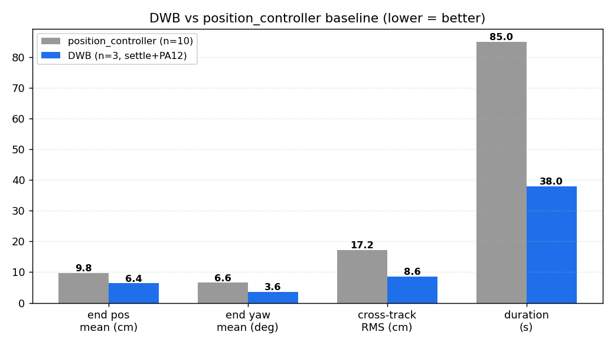
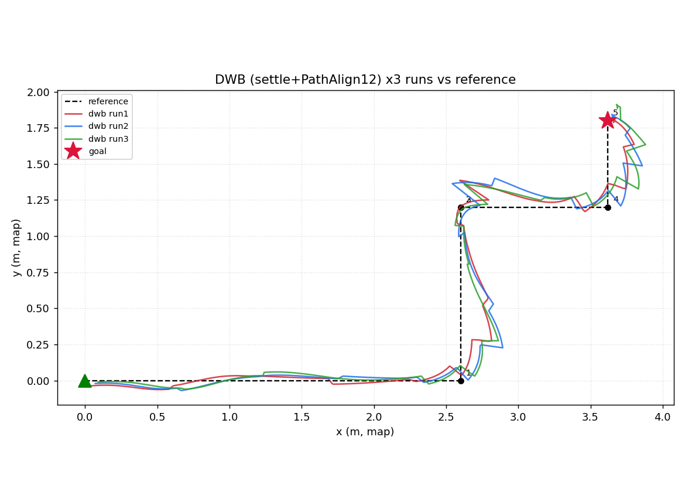
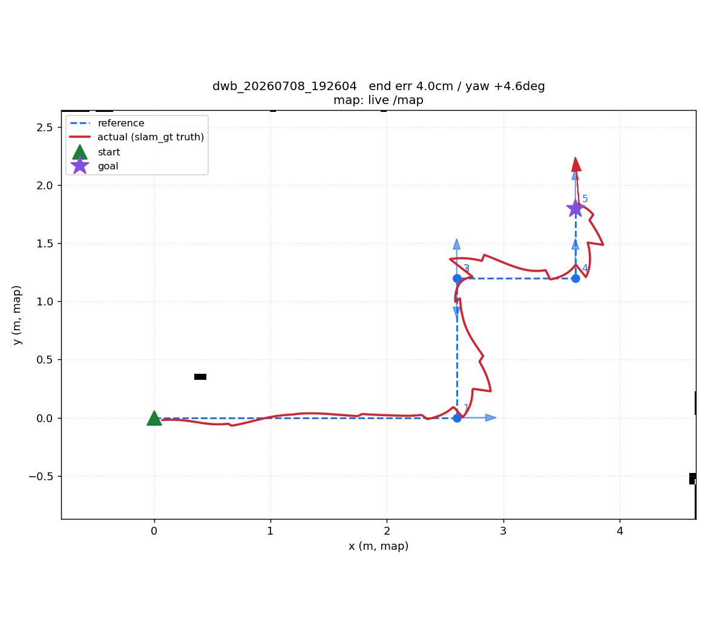

# DWB 控制 固定测试报告(纯 DWB,口径 A)

- 日期：2026-07-08
- 分支：`feature/dwb-control-opt`
- 被测：nav2 **DWB**(`dwb_core::DWBLocalPlanner`),口径 A —— controller_server 直连 `/cmd_vel`,
  绕 planner,`FollowPath` 吃 controller_bench 的**固定折线**(与 position_controller 同一参考)。
- 真值：`david_slam_gt` 的 `/groundtruth/pose`(20Hz,忽略定位漂移)。
- 样本：**3 次成功 run**(settle 修复后 + PathAlign 12 配置)。对照
  [position_controller 10 次 baseline](2026-07-07-position-controller-bench-10run-report.md)。

---

## TL;DR

**DWB 全面优于 position_controller,且提升显著。**

| 维度 | position_controller (n=10) | **DWB (n=3)** | 提升 |
|---|---|---|---|
| 终点位置 均值 / max | 9.8 / 17.2 cm | **6.4 / 11.0 cm** | ✅ |
| 终点 yaw 均值 / max | 6.6° / 10.3° | **3.6° / 4.6°** | ✅ |
| yaw 系统 bias | **+5.8°** | **+1.0°** | ✅ 超调基本消失 |
| cross-track RMS | 17.2 cm | **8.6 cm** | ✅ 约一半 |
| 直行段横漂 | −30 cm | ~−4 cm | ✅ 主动纠偏 |
| 时长 | ~85 s(停-转-走) | **38 s**(连续) | ✅ <一半 |
| 可靠性 | 10/10 | 3/3 | = |



**三个核心发现**:① **DWB 连续闭环 + 参数优化**把 baseline 最大的两个短板(直行漂 30cm、耗时长)
根本改善;② 一个**测量 bug 被修正**——baseline 的 yaw 是"到达即读、机身还在收敛"时读的,虚高;
DWB 用 settle 修复后 yaw 均值仅 3.6°、bias +1.0°(近乎无系统超调);③ **残余缺陷=角度蛇行 +
过冲**,仍指回角速度 plant 2.5× + caster 动量,**DWB 参数能缓解、治不了根**。

---

## 1. 测试方法

- **固定折线**同 baseline(`reference_path.yaml`,起点(0,0,0°)→(3.62,1.8,90°),覆盖 S1–S4)。
  DwbFollowPathAdapter 把折线 densify 成 dense Path(跳过纯原地转退化段,末点=goal yaw),整条发
  `FollowPath`(controller_id=FollowPath, goal_checker=general_goal_checker)。
- **DWB 配置**:`config/dwb_bench_params.yaml`(独立于生产)。相对生产的优化 + 调参历程:

| 项 | 生产值 | 本 bench | 说明 |
|---|---|---|---|
| `controller_frequency` | 10 | 20 | cross-track/抖动 |
| `general_goal_checker` yaw / xy | 3.14 / 0.30 | 0.087(5°) / 0.10 | 生产**完全不约束朝向** |
| `sim_time` | 1.2 | 1.5 | 平滑前瞻 |
| `PathDist.scale` | 24 | 30 | 位置贴合 |
| `PathAlign.scale` | 12 | **iter1=16→iter2=12** | 16 逼航向过猛致蛇行,回 12 |

- **测量修复(重要)**:原 `run_bench` 在 FollowPath 完成瞬间读终点,但机身此刻仍在末端
  RotateToGoal + caster 滑行(实测末端 6 样本 yaw 97.8°→89.1° 仍在收敛)→ **虚报 yaw 超调**。
  已加 `--settle-sec`(等真值位姿停稳再读)。**本报告 3 个 run 均为修复后数据;baseline(n=10)是
  修复前测的,其 yaw +5.8° 亦可能偏高,严格对比需用 settle 重测 baseline(见 §7)。**

---

## 2. 可靠性

**3/3 成功**,每次单条 FollowPath 一次到位,无 abort / 卡死 / 撞。

---

## 3. 精确性(终点 vs goal)

| 量 | DWB (n=3) | baseline (n=10) |
|---|---|---|
| 位置误差 均值 / max | **6.4 / 11.0 cm** | 9.8 / 17.2 cm |
| yaw 误差 均值 / max | **3.6° / 4.6°** | 6.6° / 10.3° |
| 位置 bias | +5.7 cm(+4.7, +3.2) | +7.2 cm |
| **yaw bias** | **+1.0°** | +5.8° |

**yaw 系统超调基本消失**(+5.8°→+1.0°,且三次 −3.9/+4.6/+2.2° 混号)——一半是 DWB 末端
RotateToGoal 收得好,一半是 settle 修复挤掉了 baseline 的虚高。位置仍有 **+5.7cm 系统性过冲**
(冲过 goal 停在 +x/+y 侧,见 §7)。

---

## 4. 稳定性(重复性)

| 量 | DWB (n=3) |
|---|---|
| std_x / std_y | 1.4 / 4.2 cm |
| yaw_std | 3.6° |

> ⚠ **n=3,仅供初判**。单跑噪声已见(如某 run 位置 11cm vs 另两次 4cm),CEP/std 需 ≥10(报 CEP95
> 需 30)次才可靠。下一步先补样本再下稳定性结论。

---

## 5. 跟踪性能(实际 vs 固定折线)

- cross-track **RMS 8.6 cm**(baseline 17.2)、单 run max 22–29 cm(baseline 45–67)。
- **直行段主动纠偏**:S1 横漂从 baseline −30cm 降到 ~−4cm —— 这是 DWB 相对 turn-drive-turn
  最本质的优势(连续闭环 vs 盲走直线)。
- 残余大 cross-track 集中在 **90° 拐点**(冲过 ~22–29cm),尖角路径 + 动量所致。



---

## 6. 流畅度(DWB 的剩余短板)

- cmd_vel **v 全程 0 反向**(无倒车,连续前进);
- 但 **w(角速度)反向 24–34 次/run** —— 直行段可见**蛇行**(左右摆头)。iter2 已把 iter1 的 35 次
  降到 23–34,但未消。
- 拐点 + 终点仍有过冲(位置 bias +5.7cm 即终点冲过)。

---

## 7. 关键发现与诚实边界

1. **DWB >> position_controller**,且提升来自"连续闭环 + 目标容差收紧 + 频率抬高",不是玄学。
2. **settle 测量修复**改变了结论:baseline 的 +5.8° yaw 超调**部分是测量假象**;要完全公平,应
   用 settle 重测 position_controller baseline(建议做,否则 yaw 一栏不是严格同口径)。
3. **残余蛇行(w 反向 24–34)+ 位置过冲 +5.7cm + 拐点冲 ~25cm**,都指回**角速度 plant ~2.5× +
   caster 动量**:DWB 命令小 w → 实际大转 → 反打 → 蛇行;终点命令停 → 机身滑过。**参数可压,不可根治。**
4. **门框验收对照**:位置 6.4cm、yaw 3.6° 已逼近验收(≤5cm / ≤5°);直行段 ~4cm 对"直线穿门"够用;
   但拐点 max cross-track 22–29cm 仍超门框净空——**穿门场景(直线段)DWB 基本可用,复杂拐弯不达标**。
   **"换全向轮"的根治结论不变**(见 [验收标准](David底盘导航验收标准_2026-07-07.docx))。

---

## 8. 结论与下一步

**结论**:纯 DWB(settle+PA12)在同一固定用例上**全面且显著优于 position_controller**(位置 −35%、
yaw 超调基本消、贴合度约一半、耗时不到一半),已逼近门框直线穿越的精度要求。剩余蛇行/过冲是底盘
plant 问题,非控制器可根治。

**下一步(排序)**:
1. **补样本**:DWB 当前配置再跑到 n≥10(最好 30),`bench_metrics.py --controller dwb` 出稳定性分布;
   并**用 settle 重测 position_controller baseline** 做严格同口径对比。
2. **压蛇行**:上 `Oscillation` critic(scale + reset 参数,惩罚方向翻转)或 `max_vel_theta 0.50→0.35`。
3. **收位置过冲**:`xy_goal_tolerance 0.10→0.05`(注意有一部分是动量 + 定位信念-真值差)。
4. **根治**:固件角速度标定 + 换全向轮(消 caster 动量与 2.5× 角增益)。

---

## 附录

### A. 逐 run 明细(settle + PathAlign 12)

| run | 状态 | 时长s | 位置误差cm | yaw误差° | ct RMS cm | ct max cm | w反向 |
|---|---|---|---|---|---|---|---|
| dwb_20260708_191827 | ✅ | 37 | 4.3 | −3.9 | 7.4 | 22 | 31 |
| dwb_20260708_192604 | ✅ | 41 | 4.0 | +4.6 | 9.1 | 29 | 24 |
| dwb_20260708_192900 | ✅ | 38 | 11.0 | +2.2 | 9.3 | 26 | 34 |
| **均值** | | **38** | **6.4** | **3.6(abs)** | **8.6** | **26** | **30** |

（另有 2 次调参历史 run:`S1S4_dwb01`=PathAlign16(蛇行 35)、`dwb_190558`=PA12 但 settle 修复前
终点虚高,均不计入本统计。）

### B. 复现

```bash
# 起纯 DWB(口径A):ros2 launch david_nav dwb_bench_bringup.launch.py  (.bashrc alias 7)
# 跑:  ./run_bench.sh --controller dwb --battery-v <V>               (.bashrc alias 8)
python3 bench_metrics.py --controller dwb --out /tmp/dwb_report.md
```

### C. 单 run 示例(dwb_20260708_192604)


